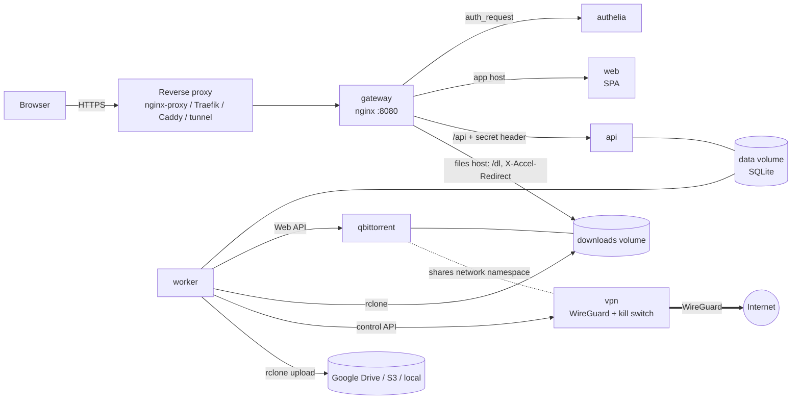

# docker-seedbox

A self-hosted, multi-user **torrent-to-cloud seedbox** in a handful of containers. Paste a magnet link or upload a `.torrent`, it downloads (optionally through a rotating WireGuard VPN with a kill switch), then ships the result to Google Drive, S3-compatible storage (Backblaze B2, MinIO, R2, ...) or a local folder and gives you a download link. Logins are handled by [Authelia](https://www.authelia.com); everything else is configured from a web admin UI.

> Only download content you have the right to download. See [Legal](#legal).

## Features

- **Multi-user** with Authelia (file-based users, groups, optional 2FA) or bring your own SSO proxy.
- **Destinations**: Google Drive (shared account, optional Cloudflare Worker proxy for signed links), any S3-compatible bucket (incl. Backblaze B2), or a local folder served with signed links.
- **VPN**: WireGuard sidecar with a kill switch; upload several configs and rotate manually, on an interval, or on failure. qBittorrent shares the VPN's network namespace, so no tunnel means no traffic.
- **Limits**: active jobs per user, maximum torrent size, minimum free disk, seeding ratio.
- **Live progress** in the browser (server-sent events).
- **Magnet links**: optionally register the app as your browser's `magnet:` handler (Chrome, Edge, Firefox; installed PWA); links pre-fill the add form and are never started automatically. See [Browser integration](docs/configuration.md#browser-integration).
- **Small attack surface**: one entry point (the gateway), no Docker socket mounts in the app stack, secrets encrypted at rest, signed download links.
- **Reuses open source**: Authelia, nginx, nginx-proxy + acme-companion, qBittorrent, rclone, WireGuard.

<!-- Screenshots: add docs/img/*.png and reference them here. -->
*Screenshots: coming soon.*

## Quick start

You need a Linux server with Docker + Compose v2, ports 80 and 443 free, and three DNS records (`seedbox.example.com`, `auth.seedbox.example.com`, `files.seedbox.example.com`) pointing at it.

```sh
git clone https://github.com/ma-04/docker-seedbox.git
cd docker-seedbox
./setup.sh
```

`setup.sh` asks for your domain and an admin e-mail, generates every secret, creates the admin login, starts the stack and prints the URLs. Re-running it is safe. Already have a reverse proxy? It detects a running `nginx-proxy` and joins it instead (see [docs/deployment.md](docs/deployment.md)). Non-interactive: `./setup.sh --domain seedbox.example.com --admin-email me@example.com --yes`.

`setup.sh` installs the newest release of the published images; while none exists yet it offers to build them from your clone instead. Then: log in, open **Admin**, add a destination, optionally upload WireGuard configs. Useful later: `./setup.sh add-user`, `./setup.sh update` (shows `1.2.3 -> 1.3.0`, `--version` pins), `./setup.sh backup` / `restore`, `./setup.sh doctor`. Requires Docker Engine 26+ and Compose 2.26+.

## Architecture



The gateway is the only entry point. See [docs/architecture.md](docs/architecture.md) for the full contract between components.

## Configuration overview

| Topic | Where | Details |
|---|---|---|
| Hostnames, secrets, proxy mode | `deploy/.env` (written by `setup.sh`) | [docs/configuration.md](docs/configuration.md) |
| Destinations (Drive, S3/B2, local) | Admin UI | [docs/configuration.md](docs/configuration.md#destinations) |
| Drive links through a Cloudflare Worker | `apps/drive-proxy` | [apps/drive-proxy/README.md](apps/drive-proxy/README.md) |
| VPN configs and rotation | Admin UI | [docs/configuration.md](docs/configuration.md#vpn) |
| Limits and seeding | Admin UI | [docs/configuration.md](docs/configuration.md#admin-ui-settings) |
| Proxy modes, DNS, upgrades, backups, external SSO | | [docs/deployment.md](docs/deployment.md) |

## Roadmap

- Per-user "Connect Google Drive" (OAuth; the groundwork exists but it is not a supported feature yet).
- Direct-link and Google-Drive-source downloaders (the downloader interface is ready for them).

## Documentation

[Deployment](docs/deployment.md) - [Configuration](docs/configuration.md) - [Architecture](docs/architecture.md) - [Releasing](docs/releasing.md) - [Security](SECURITY.md) - [Contributing](CONTRIBUTING.md) - [Third-party licenses](THIRD_PARTY_LICENSES.md) - [NOTICE](NOTICE)

## Legal

docker-seedbox is a tool. You are responsible for what you download and share with it. Only use it for content you own, that is in the public domain or under a free license, or that you otherwise have the right to download. Operators of public instances are responsible for their users' activity. A VPN does not make unlawful use lawful.

## License

[GNU AGPL-3.0](LICENSE). If you run a modified version as a network service you must offer its source to its users.

**Where the source is.** The complete corresponding source of every published image is this repository at the tag that names the image version (`:1.2.3` is `v1.2.3`; `:edge` is `main`); each image carries `org.opencontainers.image.source` and `org.opencontainers.image.revision` labels pointing at the repository and commit, and `./setup.sh --build` rebuilds all of it from a clone. For people who use a running instance over the network, the web UI footer is meant to link to the repository and the running commit (AGPL section 13; maintained with the web app); if you run a modified build, point that link at your own source. The images also contain third-party software under its own licenses (qBittorrent GPL-2.0+, libtorrent BSD, rclone MIT, nginx BSD-2, wireguard-tools and nftables GPL-2.0, Authelia Apache-2.0, ...): see [THIRD_PARTY_LICENSES.md](THIRD_PARTY_LICENSES.md) and [NOTICE](NOTICE).
